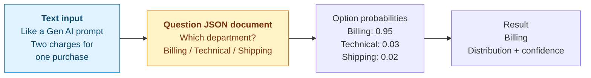
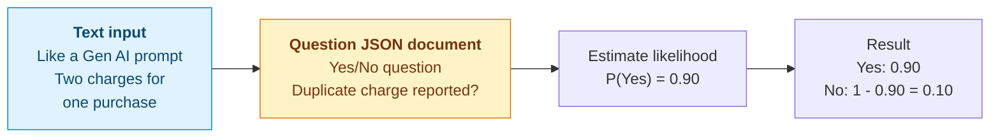
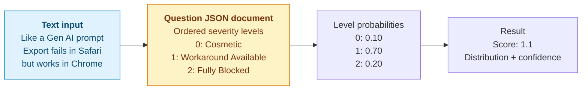

# SystemOne Decisions

A .NET Console application demonstrating (Jev-like) AI decisions through the SystemOne and Decisions APIs on Local AI or Microsoft Foundry AI. Select SystemOne - Decision1, Local AI, or Decisions - GPT-6-Luna to explore the matching examples. The 18 basic and advanced menu examples focus on business decisions where these decision models are a potential great fit.

## Contents

- [Intro](#intro)
- [Quick start](#quick-start)
- [How do these (Jev-like) Decision Models work?](#how-do-these-jev-like-decision-models-work)
- [Basic Decision Examples](#basic-decision-examples)
- [Advanced Decision Examples](#advanced-decision-examples)
- [Run the Console Application](#run-the-console-application)
- [Download LM Studio and a Decision Model](#download-lm-studio-and-a-decision-model)
- [User Secrets](#user-secrets-for-local-apis-and-microsoft-foundry)
- [Example files](#example-files)
- [JSON formats](#json-formats)
- [Build and publish](#build-and-publish)
- [Validation](#validation)
- [Sources](#sources)

## Intro

Jev-like Decision APIs, such as the [Jev (TypeSafe AI)-compatible SystemOne API](https://lmstudio.ai/docs/developer/jev-compat/systemone), expose AI judgments as typed, structured results. An application supplies the current situation, questions, and decision criteria. The model returns a choice with probabilities, the probability that a Yes/No condition is true, or a score against an ordered rubric. These outputs give software a clear contract for consuming AI judgments while making uncertainty visible.

Decision APIs are important because applications need actionable judgments for tasks such as routing customer requests, prioritizing work, and evaluating alternatives. Contrast this with Generative AI models that you have used (GPT-6, Opus etc.), where these models can provide structured output, but they are really targeting unstructured output (lots of text, new images). 

Quantitative structured outputs make those judgments easier to integrate. Why? Because they output probabilities, confidence scores based on math! I can add, subtract, compare, sort numbers...can't really do that easily with a Generative AI output that is many paragraphs. They also make decision quality measurable: predictions can be compared with observed outcomes using Brier scores and macro calibration checks. This repository demonstrates these ideas through local and hosted APIs, combining decision outputs with decision rules, framing, and updates as new evidence arrives.

## Quick start

Run your first decision locally with LM Studio. This path uses Local AI and does not require Microsoft Foundry credentials.

1. **Install .NET and get the code.** Install the [.NET 10 SDK](https://dotnet.microsoft.com/download/dotnet/10.0), then clone the repository and open its root folder in a terminal:

   ```sh
   git clone https://github.com/bartczernicki/SystemOneDecisionsConsole.git
   cd SystemOneDecisionsConsole
   ```

   If you already have the code, open a terminal in the existing repository root instead. Run all commands below from that folder.

2. **Load a decision model and start LM Studio's server.** Install [LM Studio](https://lmstudio.ai/download) with an inference runtime that supports the [SystemOne endpoint](https://lmstudio.ai/docs/developer/jev-compat/systemone). In **Discover**, paste the [Clef-Flash model URL](https://huggingface.co/ggml-org/Clef-Flash-GGUF), download a model that fits your machine, and load it. Note the loaded model's exact identifier. In the [Developer tab](https://lmstudio.ai/docs/developer/core/server), turn on **Start server** and leave it running. The commands below assume the server address is `http://localhost:1234`.

3. **Configure the local endpoints and model.** Replace `your-loaded-model-id` with the identifier from LM Studio. If your server uses a different address or port, update both endpoint URLs while keeping their `/v1/...` paths:

   ```sh
   dotnet user-secrets set "LocalSystemOneAPI" "http://localhost:1234/v1/systemone" --project SystemOneDecisionsConsole/SystemOneDecisionsConsole.csproj
   dotnet user-secrets set "LocalDecisionsAPI" "http://localhost:1234/v1/decisions" --project SystemOneDecisionsConsole/SystemOneDecisionsConsole.csproj
   dotnet user-secrets set "LocalDecisionModel" "your-loaded-model-id" --project SystemOneDecisionsConsole/SystemOneDecisionsConsole.csproj
   ```

   These settings are stored outside the repository. Existing environment variables with the same names override User Secrets.

4. **Run the console application:**

   ```sh
   dotnet run --project SystemOneDecisionsConsole
   ```

5. **Try the first example.** Select **1) Basic Decision Examples**, then **1) SystemOne API (Local AI) - Choice**. Local AI is the default on first run. To select it again, use **3) Configure → 2) Decision provider → 2) Local AI**, then return to the main menu.

   A successful response shows your provider and model, a department recommendation (normally **Billing** for the duplicate-charge complaint), confidence, and probability bars for Billing, Technical, and Shipping. The model's recommendation and probabilities can vary. Press **Enter** to return to the menu.

## How do these (Jev-like) Decision Models work?


<br/>  

See the [OpenAI Decisions Guide](https://developers.openai.com/api/docs/guides/decisions) for the Decisions API concepts and examples.  
See the [TypeSafe SystemOne Guide](https://docs.typesafe.ai/api) for the SystemOne API concepts and examples.

The examples below supply **text input**, like a Gen AI prompt, and a **JSON document** defining the question and its criteria. In each diagram, blue highlights the text input and yellow highlights the question JSON document.

All probabilities and results in the diagrams below are illustrative, not recorded model responses.

### Choice: select one option

Use `choice` to select one category from a fixed set. Describe when each option applies: Billing handles payments and refunds, Technical handles product problems, and Shipping handles deliveries.



**API fields:** SystemOne defines options in a `criteria` object; Decisions uses a `choices` array with `value` and `description`. Both return `choice`, `probabilities`, and a separate `confidence` value.

### Yes/No: noul / predicate

Use SystemOne's `noul` or Decisions' `predicate` to estimate the probability that a condition is true. The probability ranges from 0 to 1; the probability of No is `1 - P(Yes)`. The console displays both probabilities without applying a boolean threshold.



**API fields:** SystemOne uses `type: "noul"`, can describe true/false outcomes in `criteria`, and returns the Yes probability as `noul`. Decisions uses `type: "predicate"` and returns it as `probability`. Both use `instructions` to define the condition.

### Score: rate against ordered levels

Use `score` to rate an input against a rubric ordered from lowest to highest. For the export example, Cosmetic means no lost functionality, Workaround Available means the task can be completed another way, and Fully Blocked means no workaround exists.



The score is the probability-weighted average of the level indices: `0 * 0.10 + 1 * 0.70 + 2 * 0.20 = 1.1`. Indices start at 0, so three levels give a score range of 0 to 2. A score can fall between levels; it summarizes the distribution rather than selecting a single category.

**API fields:** SystemOne supplies an ordered `criteria` array; Decisions supplies an ordered `levels` array with `label` and `description`. Both return `score`, `probabilities`, and a separate `confidence` value.

The concepts in this repository are based on Bart Czernicki's book, [Decision Intelligence with AI](https://github.com/bartczernicki/decision-intelligence-with-ai). The [interactive version](https://www.decisionintelligencebook.ai) provides further context and examples for applying Decision Intelligence with AI.

## Basic Decision Examples

The tables below show the complete Local AI menus. Basic examples match the selected API and are numbered from 1. GPT-6-Luna also runs all 12 advanced examples through the Decisions API:

| Decision provider | API and model | Basic examples | Advanced examples |
| --- | --- | --- | --- |
| SystemOne - Decision1 | SystemOne API on Microsoft Foundry AI, using the Decision1 deployment | 3 | 11 |
| Local AI | SystemOne and Decisions APIs, using the local model | 6 | 12 |
| Decisions - GPT-6-Luna | Decisions API on Microsoft Foundry AI, using the GPT-6-Luna deployment | 3 | 12 |

| Option | Example | What it demonstrates |
| --- | --- | --- |
| 1 | SystemOne API - Choice | Routes a customer's report of two charges for one purchase to Billing, Technical, or Shipping. Shows the recommended department and its probability distribution. |
| 2 | SystemOne API - Yes/No (noul) | Evaluates whether a customer reports being charged twice for the same purchase. Shows the probability of Yes without applying a boolean threshold. |
| 3 | SystemOne API - Score | Rates a CSV export failure in Safari when Chrome provides a working alternative. Shows a probability-weighted severity score across Cosmetic, Workaround Available, and Fully Blocked levels. |
| 4 | Decisions API - Choice | Routes a customer's report of two charges for one purchase to Billing, Technical, or Shipping. Shows the recommended department and its probability distribution. |
| 5 | Decisions API - Yes/No (predicate) | Evaluates whether a customer reports being charged twice for the same purchase. Shows the probability of Yes without applying a boolean threshold. |
| 6 | Decisions API - Score | Rates a CSV export failure in Safari when Chrome provides a working alternative. Shows a probability-weighted severity score across Cosmetic, Workaround Available, and Fully Blocked levels. |

Every menu item includes its provider, for example **SystemOne API (Local AI) - Choice** or **Decisions API (Microsoft Foundry AI) - Choice**. SystemOne - Decision1 shows the first three basic examples. Decisions - GPT-6-Luna shows Choice, Yes/No (predicate), and Score as options 1–3.

## Advanced Decision Examples

| Option | Example | What it demonstrates |
| --- | --- | --- |
| 1 | SystemOne API - Football Game Probability Forecast | Forecasts an Atlanta Falcons at Green Bay Packers game from a halftime snapshot. One request estimates the winner, Green Bay's chance of covering the spread, and final total-points bands. |
| 2 | SystemOne API - Football Total Points Cumulative Probability | Forecasts combined final points from the same football halftime snapshot. Adds probabilities across the relevant score bands to show the chance of strictly more than 40 points. |
| 3 | SystemOne API - Shipment Arrival Evidence with Bayesian updating | Forecasts a fictional shipment's arrival using three successive evidence updates at a fixed forecast time. Compares live arrival-window distributions, entropy, and confidence as more information becomes available. |
| 4 | SystemOne API - Customer Subscription Brier Score and Calibration | Predicts term-deposit subscriptions for 200 recorded customers from UCI Bank Marketing. Scores representative and previous-success groups separately with Brier score and ECE, and saves complete results. |
| 5 | Decisions API - Courier Logistics Package Shipping Decision | Evaluates two package photographs in separate requests against a fictional Express Delivery policy. Shows six Pass/Fail/Unknown shipping checks and an overall Ship, Repack or Relabel, or Needs Inspection decision for each package. |
| 6 | SystemOne API - Apple Watch Step Goal with 10,000 Step Decision Rule | Compares visiting the park, taking a walk, or running from a 5,000-step starting point. Reports an independent Yes/No probability for each activity reaching the 10,000-step goal. |
| 7 | SystemOne API - Energy Plant Investment Strategy with Decision Framing | Recommends a fictional solar-and-battery investment strategy through Creativity, Caution, and Benefits thinking hats. Three isolated requests compare recommendation distributions using the same project facts and strategy choices. |
| 8 | SystemOne API - Work Queue Prioritization with the Eisenhower Matrix | Classifies eight operations-manager tasks by urgency and importance using separate requests. Shows the returned actions in a summary and an Eisenhower Matrix: Do Now, Schedule, Delegate, or Eliminate. |
| 9 | SystemOne API - Restaurant Choice: Decision Exploration or Exploitation? | Chooses whether a regular restaurant customer should try an unfamiliar dish or order a familiar favorite. One request evaluates the strategy and both conditional dish choices, then displays the strategy and its matching recommendation. |
| 10 | SystemOne API - Sales Conversions: Bernoulli to Binomial | Predicts one prospect’s subscription probability, then calculates the count distribution for 100 independent comparable prospects and the chance of more than 30 conversions (31 or more). |
| 11 | SystemOne API - Sales Conversions Extension: Bernoulli to Poisson-Binomial | Extends option 10 to 100 distinct prospects, using 100 isolated requests. Combines their individual conversion probabilities and compares the resulting count distribution with a Binomial using their average probability. |
| 12 | SystemOne API - Project Completion from Task Duration Distributions | Predicts three sequential stages' duration distributions in one request, then convolves them locally to show total completion time and the chance of finishing within 20 working days, including day 20. |

Local AI and Decisions - GPT-6-Luna share the 1–12 order above, including courier at option 5. With GPT-6-Luna selected, every advanced example uses the Decisions API and its configured Foundry deployment. SystemOne - Decision1 omits courier and renumbers the remaining examples 1–11. Option numbers referenced below use the Local AI and GPT-6-Luna menus.

The advanced workflows reuse the same scenario definitions and calculations across providers. GPT-6-Luna translates the shared SystemOne question definitions into native Decisions requests; no duplicate scenario folders are required. Response JSON and saved calibration `rawResponse` values retain the original Decisions responses.

The sales conversion example uses the returned Yes probability (`noul` for SystemOne or `probability` for Decisions) as the success probability `p` in `X ~ Binomial(100, p)`. It displays the Bernoulli chart, all 101 count probabilities, expected conversions `100p`, and `P(X > 30) = P(X >= 31)`. These are local calculations, with no sampling or extra model calls. The synthetic cohort assumes independent prospects sharing the same probability; uncertainty in the estimated `p` is not modeled separately.

The Poisson-binomial extension stores 100 synthetic profiles in `prospects.json`, with 20 at each of five engagement stages. It validates all profiles before calling the model, then predicts each prospect in isolation. The console shows progress, a probability table, the count distribution, expected conversions, standard deviation, and `P(X > 30)`. The comparison `Binomial(100, average p)` uses the same predictions and therefore the same expected count, while its variance and tail probability can differ. Outcomes are assumed independent and each estimated probability is treated as fixed. If any request fails, processing stops without a completed-cohort forecast.

The project completion example requests three `choice` distributions for design (exactly 3, 5, or 7 working days), implementation (5, 8, or 11), and testing and release (2, 4, or 6). It displays the stage distributions and expectations, then convolves their full distributions to calculate total duration from 10 through 24 working days, expected completion time, `P(T <= 20)`, and `P(T > 20)`. The calculation sums actual durations and includes completion exactly on day 20. The synthetic project assumes fixed scope, separate teams, sequential execution, immediate handoffs, and independent stage durations conditional on the evidence. Selected choices and confidence values are not used as the project's on-time probability. All three answers must be valid before any charts or project forecast appear; accepted near-unit probability distributions are normalized for calculation while the original response JSON is preserved.

## Run the Console Application

Install the .NET 10 SDK. Configure the local API settings for Local AI, or the Foundry gateway endpoint, deployment name and API key for your hosted selection below. The default local model is `clef-flash`; set `LocalDecisionModel` if your server uses a different identifier. Run from the repository root:

```sh
dotnet run --project SystemOneDecisionsConsole
```

Use a terminal that supports ANSI RGB colors to display the cyan banner and gold menu.

The top-level menu includes **3) Configure**. Select **1) Show / Hide Decision JSON** to toggle the raw `Response JSON:` blocks; the menu shows the current state. JSON starts **hidden**, and each toggle is saved immediately for subsequent responses and future runs.

Select **2) Decision provider** to choose **1) SystemOne - Decision1**, **2) Local AI** (the default), or **3) Decisions - GPT-6-Luna**. Selection validates the configured endpoint, model and authentication without making an API request, then displays the model name or Foundry model deployment. Missing or invalid settings and failed saves leave the current selection unchanged. Every example states its API, provider and model before running. Basic menus show matching native API examples; GPT-6-Luna includes all 12 advanced workflows.

Preferences are stored in `Configuration.json` in the current working folder (the repository root when using the command above). The application creates this file on first run with:

```json
{
  "ShowDecisionJson": false,
  "DecisionProvider": "LocalAI"
}
```

`DecisionProvider` can be `SystemOneDecision1`, `LocalAI`, or `DecisionsGPT6Luna`. Legacy `SystemOneProvider` values are still read: `LocalAI` maps to Local AI and `MicrosoftFoundryAI` maps to SystemOne - Decision1. `DecisionProvider` takes precedence when both properties exist; files without either use Local AI. Loading an existing file does not rewrite it. The next successful preference save uses `DecisionProvider`. Provider changes and JSON toggles preserve each other's settings. Only preferences are stored here; endpoints, model names and credentials remain in User Secrets or environment variables. Environment variables override matching User Secrets for both selection and execution.

Manual edits take effect the next time the application starts. When JSON is hidden, HTTP errors still show their status and reason, while raw response bodies are omitted. Summaries, charts, and saved evaluation reports remain available. Enabling JSON also displays each of the 200 customer calibration responses. If configuration cannot be loaded, the application warns and uses the defaults without overwriting the file; failed saves retain the previous settings. Execution reports configuration errors without switching providers automatically.

## Download LM Studio and a Decision Model

For Local AI, install LM Studio and load a decision model such as Clef or Clef-Flash:

1. Download the installer for your operating system from the [LM Studio download page](https://lmstudio.ai/download) and install the application.
2. Open **Discover** and search for `Clef` or `Clef-Flash`. For a concrete download, paste the [ggml-org/Clef-Flash-GGUF model URL](https://huggingface.co/ggml-org/Clef-Flash-GGUF) into the search bar. LM Studio supports searching by model name or Hugging Face URL; see its [model download guide](https://lmstudio.ai/docs/app/basics/download-model).
3. Open the **Model Server** tab and turn on **Start server**. The usual local address is `http://localhost:1234`; use the address and port shown by your server. See the [LM Studio server guide](https://lmstudio.ai/docs/developer/core/server).
4. Select **Load Model** to load the downloaded model in LM Studio and note its model identifier. Use that exact identifier for `LocalDecisionModel` in the User Secrets section below; the console defaults to `clef-flash`.

**Important Note:** For multi-question and image examples, both **Eval Batch Size** and **Physical Batch Size** must accommodate the combined input and questions. The effective physical batch is capped by Eval Batch Size. Start with `4096` for both and reload the model after changing load settings; if a request exceeds that limit, increase both to accommodate it. Larger physical batches require more working memory. See the [llama.cpp batch limit implementation](https://github.com/ggml-org/llama.cpp/blob/master/src/llama-context.cpp).

Use an LM Studio version and inference runtime that support the selected decision model and the [SystemOne](https://lmstudio.ai/docs/developer/jev-compat/systemone) (`/v1/systemone`) and [Decisions](https://lmstudio.ai/docs/developer/openai-compat/decisions) (`/v1/decisions`) endpoints. The local courier example (Advanced #5) also requires image-capable Clef/Clef-Flash support and its matching vision adapter (`mmproj`). SystemOne - Decision1 and Decisions - GPT-6-Luna use hosted deployments and do not require a local server.

## User Secrets for local APIs and Microsoft Foundry

The project has a `UserSecretsId` configured and loads these settings with `Microsoft.Extensions.Configuration.UserSecrets`. Store both local API and Microsoft Foundry settings in the same project's User Secrets, outside the repository. Each developer needs to configure the settings for their chosen backend on their own machine. The table lists all nine supported settings.

| Provider | Secret key | Requirement | Value |
| --- | --- | --- | --- |
| Local AI | `LocalSystemOneAPI` | Required | `http://localhost:1234/v1/systemone` |
| Local AI | `LocalDecisionsAPI` | Required | `http://localhost:1234/v1/decisions` |
| Local AI | `LocalDecisionModel` | Optional; defaults to `clef-flash` | The loaded model identifier. |
| SystemOne - Decision1 | `MicrosoftFoundrySystemOneAPI` | Required | `https://<your-gateway-name>.azure-api.net/<your-foundry-name>/providers/microsoft/v1/systemone` |
| SystemOne - Decision1 | `MicrosoftFoundryDecisionModelDeploymentName` | Required | Your Decision1 deployment name, for example `Decision-1-Global`. |
| SystemOne - Decision1; Luna fallback | `MicrosoftFoundryAPIKey` | Required for Decision1; required for Luna only when its dedicated key is absent | The API key accepted by the selected endpoint. |
| Decisions - GPT-6-Luna | `MicrosoftFoundryDecisionsAPI` | Required | The full Decisions operation URL for the Luna deployment, for example `https://<your-resource-name>.openai.azure.com/openai/v1/decisions`, or your gateway's full Decisions route. |
| Decisions - GPT-6-Luna | `AzureOpenAIGPT6LunaModelDeploymentName` | Required | Your GPT-6-Luna deployment name. |
| Decisions - GPT-6-Luna | `MicrosoftFoundryDecisionsAPIKey` | Required unless using the shared key fallback | The dedicated API key accepted by `MicrosoftFoundryDecisionsAPI`. |

GPT-6-Luna sends requests directly to `MicrosoftFoundryDecisionsAPI`, preserving its configured path and query string. Set the full Decisions operation URL for your supported-region deployment or gateway route. This setting is required for GPT-6-Luna and is independent of `MicrosoftFoundrySystemOneAPI`. The request's `model` is the configured deployment name for the selected backend. SystemOne uses `MicrosoftFoundryAPIKey`; Decisions uses `MicrosoftFoundryDecisionsAPIKey` when present, otherwise `MicrosoftFoundryAPIKey`. A direct Azure resource endpoint requires that resource's key; a gateway key can return HTTP 401 there. Credentials remain in User Secrets or environment variables.

Environment variables with these exact names override User Secrets. A configured but blank or invalid `MicrosoftFoundryDecisionsAPIKey` fails validation; the shared key fallback applies only when the dedicated setting is absent.

The gateway and its Azure backend must support the Decisions operation. Microsoft's [Azure Decisions guide](https://learn.microsoft.com/en-us/azure/foundry/openai/how-to/decisions) describes a regional rollout and excludes East US 2. A GPT-6-Luna deployment alone does not establish that the operation is available; unsupported operations are reported as API errors.

Run the commands for your selected provider from the repository root, replacing placeholders with your own values.

For **Decisions - GPT-6-Luna**, set the three Luna secrets. Use the key for the resource or gateway named in the Decisions URL:

```sh
dotnet user-secrets set "MicrosoftFoundryDecisionsAPI" "https://<your-resource-name>.openai.azure.com/openai/v1/decisions" --project SystemOneDecisionsConsole/SystemOneDecisionsConsole.csproj
dotnet user-secrets set "AzureOpenAIGPT6LunaModelDeploymentName" "your-gpt-6-luna-deployment-name" --project SystemOneDecisionsConsole/SystemOneDecisionsConsole.csproj
dotnet user-secrets set "MicrosoftFoundryDecisionsAPIKey" "your-decisions-resource-api-key" --project SystemOneDecisionsConsole/SystemOneDecisionsConsole.csproj
```

For **SystemOne - Decision1**, set its endpoint, deployment name, and API key:

```sh
dotnet user-secrets set "MicrosoftFoundrySystemOneAPI" "https://<your-gateway-name>.azure-api.net/<your-foundry-name>/providers/microsoft/v1/systemone" --project SystemOneDecisionsConsole/SystemOneDecisionsConsole.csproj
dotnet user-secrets set "MicrosoftFoundryDecisionModelDeploymentName" "Decision-1-Global" --project SystemOneDecisionsConsole/SystemOneDecisionsConsole.csproj
dotnet user-secrets set "MicrosoftFoundryAPIKey" "your-api-key" --project SystemOneDecisionsConsole/SystemOneDecisionsConsole.csproj
```

For **Local AI**, set both endpoints. The model setting is optional when using the default `clef-flash`:

```sh
dotnet user-secrets set "LocalSystemOneAPI" "http://localhost:1234/v1/systemone" --project SystemOneDecisionsConsole/SystemOneDecisionsConsole.csproj
dotnet user-secrets set "LocalDecisionsAPI" "http://localhost:1234/v1/decisions" --project SystemOneDecisionsConsole/SystemOneDecisionsConsole.csproj
dotnet user-secrets set "LocalDecisionModel" "your-loaded-model-id" --project SystemOneDecisionsConsole/SystemOneDecisionsConsole.csproj
```

Verify the configured values for your selected provider:

```sh
dotnet user-secrets list --project SystemOneDecisionsConsole/SystemOneDecisionsConsole.csproj
```

## Example files

The repository-root `Decisions` folder contains **21 scenario folders** and **75 scenario assets**, grouped into Basic and Advanced categories. The menus expose **18 distinct examples**, with availability determined by the selected provider. The three original basic Foundry folders are retained for compatibility. Local and hosted SystemOne use the shared basic SystemOne assets; Local AI and GPT-6-Luna share the native Decisions basic and courier assets. The remaining advanced scenario assets are shared across all providers.

| File | Purpose |
| --- | --- |
| `ScenarioDescription.txt` | Scenario explanation displayed in the console; excluded from the API request. |
| `input.txt` | Input/state supplied to the model. Some scenarios have multiple input.txt files. |
| `questions.json` | Question (JSON) definitions for choice, Yes/No, or score answers. |
| `*.png` | For image input, the photographs supplied as inline images by the courier example. |

Some advanced examples include additional evidence, evaluation, decision-frame, or task assets. Edit the repository-root files, then rebuild or run again.

## JSON formats

Both local and Foundry SystemOne examples follow the [Jev SystemOne schema](https://api.typesafe.ai/openapi.json) and use the same typed .NET request and response models. Their `questions.json` is a dictionary keyed by question ID. The application builds `{ "model": "...", "state": "...", "questions": { ... } }`. Choice uses `criteria` as an object, Yes/No uses `type: "noul"`, and Score uses an ordered `criteria` array. For example:

```json
{
  "Duplicate Charge": {
    "type": "noul",
    "instructions": "Does the customer report a duplicate charge?",
    "criteria": {
      "true": "Multiple charges for one purchase.",
      "false": "No duplicate charge reported."
    }
  }
}
```

Local and hosted Decisions follow the [OpenAI Decisions API reference](https://developers.openai.com/api/reference/resources/decisions/methods/create) and use typed .NET models over REST. Native Decisions assets store `questions.json` as an array of named questions. Text requests build `{ "model": "...", "input": "...", "questions": [ ... ] }`. Choice uses `choices` with `value`/`description`, Yes/No uses `type: "predicate"`, and Score uses ordered `levels` with `label`/`description`. For example:

```json
[
  {
    "name": "Duplicate Charge",
    "type": "predicate",
    "instructions": "Does the customer report a duplicate charge?"
  }
]
```

For GPT-6-Luna's shared advanced scenarios, SystemOne `noul` becomes Decisions `predicate`, with both true and false criterion descriptions preserved in the instructions. Choice criteria become named choices, and ordered score criteria become levels. Native Decisions answer arrays are mapped in memory to the existing workflow models for calculations; the displayed JSON and saved raw responses keep the native answer arrays. Hosted requests continue to use the configured `MicrosoftFoundryDecisionsAPI` endpoint and API-key authentication.

The courier example uses a typed multimodal request instead of a string `input` on both Local AI and GPT-6-Luna. Each request contains one user message with the shared policy and inspection text plus exactly one PNG. This excerpt uses the local model name and shows the final shipping question; the scenario sends all seven questions:

```json
{
  "model": "clef-flash",
  "input": [
    {
      "role": "user",
      "content": [
        { "type": "input_text", "text": "<courier policy and inspection record>" },
        { "type": "input_image", "image_url": "data:image/png;base64,<PNG bytes>" }
      ]
    }
  ],
  "questions": [
    {
      "name": "Shipping Decision",
      "type": "choice",
      "instructions": "Apply all courier requirements to this parcel.",
      "choices": [
        { "value": "Ship", "description": "Every requirement is satisfied." },
        { "value": "Repack or Relabel", "description": "At least one requirement fails." },
        { "value": "Needs Inspection", "description": "No failure is established, but required evidence is missing." }
      ]
    }
  ]
}
```

## Build and publish

```sh
dotnet build SystemOneDecisionsConsole.sln
dotnet publish SystemOneDecisionsConsole/SystemOneDecisionsConsole.csproj -c Release -o ./publish
```

## Validation

The solution includes the application and the native MSTest 4.0.2 project, `SystemOneDecisionConsole.Tests`, targeting .NET 10 with the standard VSTest runner. Run the functionality tests in either configuration:

```sh
dotnet test SystemOneDecisionsConsole.sln
dotnet test SystemOneDecisionsConsole.sln -c Release
```

The tests use isolated copies of the application's complete output for the active configuration and a concurrent loopback HTTP fixture. They require no configured model or API credentials. The suite runs serially, verifies console workflows and private validators, checks generated reports, and compares all 21 scenarios and 75 assets across source, build, and publish outputs, including the original PNG bytes. The migration coverage inventory is in [SystemOneDecisionConsole.Tests/Coverage.md](SystemOneDecisionConsole.Tests/Coverage.md).

## Sources

- Customer data: [UCI Bank Marketing](https://archive.ics.uci.edu/dataset/222/bank+marketing) by S. Moro, P. Rita, and P. Cortez, licensed under [CC BY 4.0](https://creativecommons.org/licenses/by/4.0/).
- Decision framing: [De Bono Group's Six Thinking Hats](https://www.debonogroup.com/services/core-programs/six-thinking-hats/).
- Work queue: Bart Czernicki's [Decision Intelligence with AI, Chapter 1A](https://www.decisionintelligencebook.ai/chapters/1a-introducing-the-decision-intelligence-framework.html).
- Restaurant exploration/exploitation: Bart Czernicki's [Decision Intelligence with AI, Chapter 1F](https://www.decisionintelligencebook.ai/chapters/1f-decision-execution-with-decision-rules.html).
